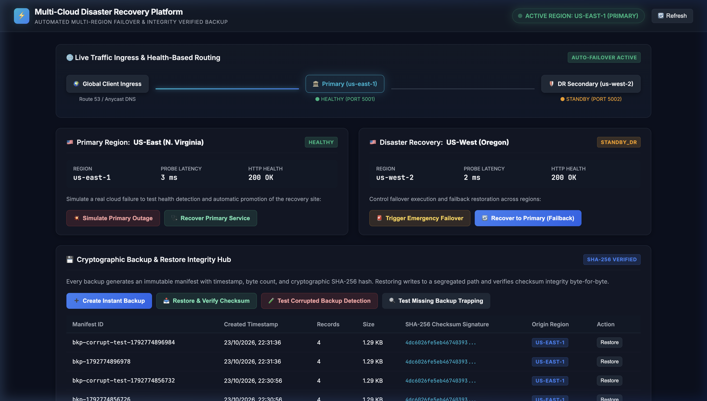
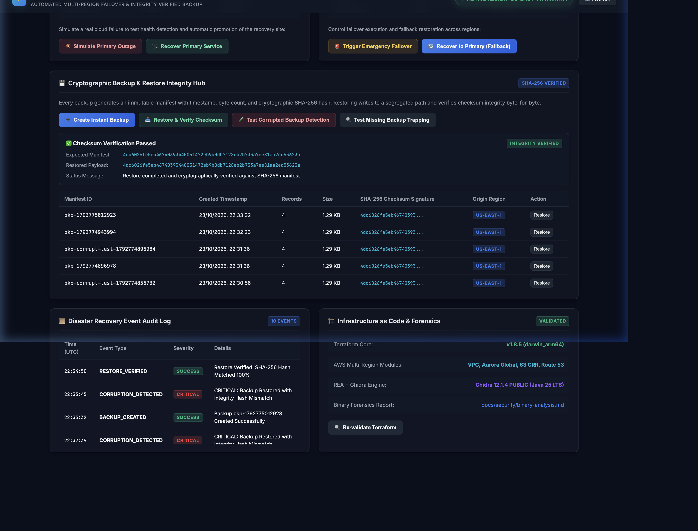
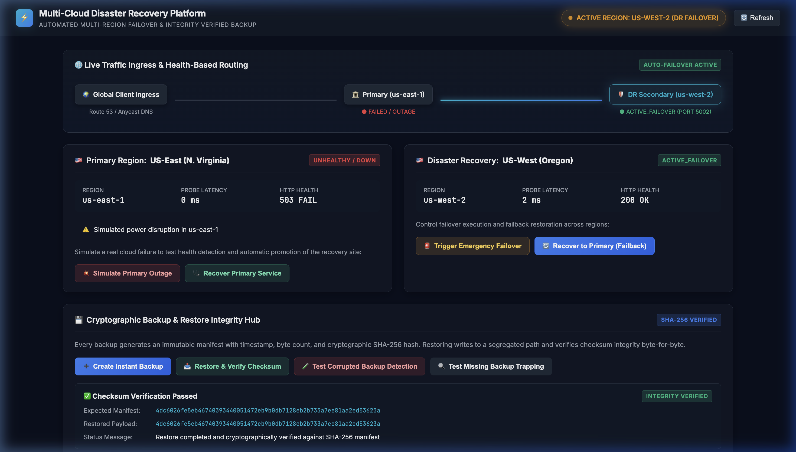
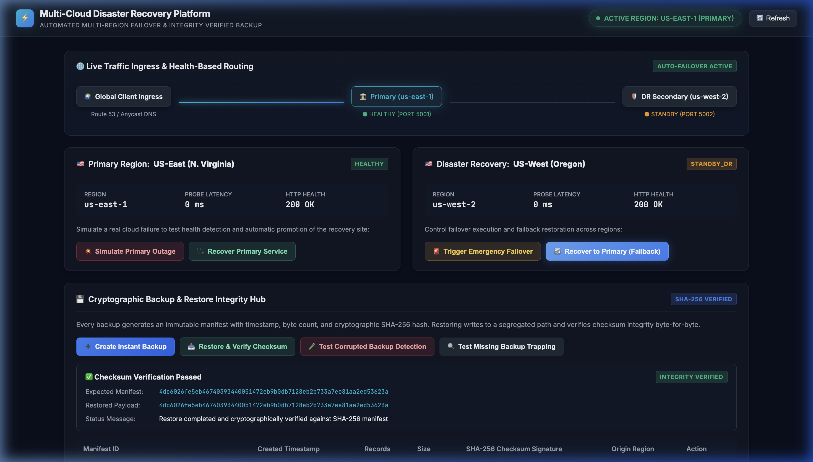
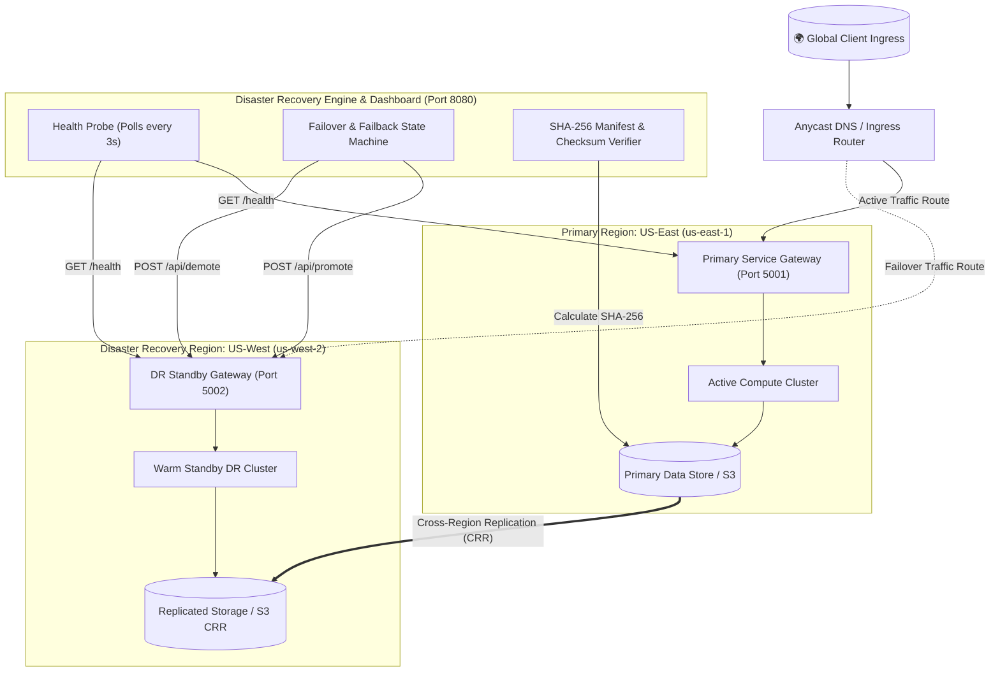

# Multi-Cloud Disaster Recovery & Automated Cryptographic Backup Platform

An enterprise-grade Disaster Recovery (DR) orchestration and automated cryptographic backup verification platform. This platform demonstrates high-availability multi-region active-standby failover between primary (`us-east-1`) and secondary (`us-west-2`) cloud microservices, continuous synthetic HTTP health probing, automated and operator-driven failover/failback, and byte-level cryptographic SHA-256 backup verification.

---

## 🏛️ Upstream Attribution & Project Scope

- **Inherited Upstream Work**: The foundational AWS multi-region Infrastructure-as-Code definitions in [`infra/`](infra/) and the AWS media server reference in [`backend/server.js`](backend/server.js) are sourced from [ShamailAbbas/aws-terraform-multi-region-active-active-disaster-recovery](https://github.com/ShamailAbbas/aws-terraform-multi-region-active-active-disaster-recovery).
- **Original Additions by Dev Rajput ([@iamDevRajput](https://github.com/iamDevRajput))**:
  - Runnable multi-region local microservices (`primary-service.js`, `dr-service.js`).
  - Disaster Recovery Orchestration Engine & health poller (`dr-engine.js`, `cluster.js`).
  - Cryptographic SHA-256 backup snapshot generator and segregated restore verification pipeline.
  - Bit-rot corruption detection and fault trapping suites.
  - Interactive dark-mode operational dashboard with real-time routing visualizer (`frontend/index.html`).
  - 10-point automated end-to-end verification test suite (`tests/automated_dr_tests.js`).
  - One-click launch automation (`scripts/start_all.sh`, `scripts/stop_all.sh`).
  - Complete architecture specifications, screenshots, and security forensics documentation.
- **Licensing Uncertainty Notice**: The upstream reference repository contains no formal open-source license file (HTTP 404). Attribution is provided for transparency, architectural context, and academic reference; attribution alone does not imply that copyright ownership or explicit redistribution rights were granted by the original author. To maintain ethical standards, upstream infrastructure definitions are clearly distinguished from original orchestration, verification, and dashboard code.

---

## 🎯 Problem Statement & Objectives

### The Problem
Mission-critical modern applications require robust Recovery Time Objectives (RTO) and Recovery Point Objectives (RPO). Traditional backup-and-restore strategies frequently suffer from:
1. **Unverified Backup Corruption**: Backups are executed regularly but never restored until an actual disaster occurs, discovering silent bit-rot or invalid data too late.
2. **Slow, Manual Failover**: Complex DNS, compute, and database promotion workflows result in extended downtime during regional cloud outages.
3. **High Cloud Infrastructure Testing Costs**: Validating multi-region failover often necessitates provisioning expensive live multi-cloud clusters.

### Project Objectives
- **Zero Cloud-Spend Verification**: Implement a high-fidelity local multi-region cluster simulation (`us-east-1` primary, `us-west-2` standby) with real HTTP health checks and promotion endpoints.
- **Sub-Second Failover & Repeatable Failback**: Continuously monitor cluster nodes, automatically trigger failover upon consecutive health check failures, and execute clean failback once the primary cluster recovers.
- **Cryptographic Backup Integrity**: Generate immutable manifests containing SHA-256 cryptographic hashes for every backup snapshot.
- **Segregated Restoration Validation**: Restore data to an isolated target path and mathematically prove 100% byte-for-byte SHA-256 integrity before database hydration.
- **Tamper & Fault Trapping**: Programmatically test corrupted backups (detecting hash mismatches) and missing backup files without application crashes.
- **Modular Terraform Foundation**: Provide valid, production-grade AWS multi-region Infrastructure-as-Code (IaC) without incurring cloud costs.

---

## 📸 Interactive Operational Dashboard

### 1. Healthy Cluster State (`us-east-1` Primary Active)
*Primary region active on port 5001 with sub-20ms health checks; DR secondary standing by on port 5002.*


### 2. Cryptographic SHA-256 Verification & Restore
*Instant snapshot generated with immutable SHA-256 manifest; segregated restore verified byte-for-byte.*


### 3. Automated Failover & DR Promotion
*Primary regional failure injected; orchestrator promotes `us-west-2` to ACTIVE_FAILOVER and shifts client ingress.*


### 4. Full Operational Platform Overview
*Complete control center showing live traffic flow visualizer, backup history, and real-time audit log.*


---

## 🏗️ System Architecture



### Detailed Component Workflows

#### 1. Real HTTP Synthetic Health Checks
- Both the primary service (`:5001/health`) and DR service (`:5002/health`) respond to real HTTP GET requests.
- The orchestrator probes both endpoints every 3 seconds, measuring probe latency, HTTP status codes, and uptime.

#### 2. Automatic Outage Detection & Failover Simulation
- An outage can be simulated via `POST /api/dr/simulate-primary-down` (or the dashboard button).
- If the primary service fails 2 consecutive health checks (`threshold = 2`), the orchestrator triggers automated failover:
  1. Issues `POST /api/promote` to the secondary service (`us-west-2`).
  2. Promotes the DR cluster from `STANDBY_DR` to `ACTIVE_FAILOVER`.
  3. Re-routes active client ingress (`/api/live/data`) to `us-west-2`.
  4. Records a `CRITICAL` severity event in the audit trail.

#### 3. Repeatable Primary Recovery & Failback
- Injecting recovery via `POST /api/dr/simulate-primary-up` brings the primary service back to `200 OK`.
- Executing failback (`POST /api/dr/failback`) verifies primary health, demotes `us-west-2` back to warm standby, re-aligns client ingress to `us-east-1`, and records a `SUCCESS` audit entry.

#### 4. Cryptographic Backup & Segregated Restore Verification
- **Backup Creation**: Takes an atomic snapshot of `data/storage/dataset.json`, writes to `data/backups/backup_<timestamp>.json`, calculates a 64-character SHA-256 digest, and saves a signed manifest `manifest_<timestamp>.json`.
- **Restore & Verification**: Restores the archive to an isolated directory `data/restored/restored_<timestamp>.json`, recomputes the SHA-256 digest on the restored file, and verifies exact equality against the manifest.
- **Bit-Rot / Tamper Detection**: Tests deliberate bit-level alterations in backup archives; the verifier detects the checksum mismatch and rejects restoration with an HTTP 422 `CORRUPTION_DETECTED` status.
- **Fault Trapping**: Validates missing archive requests and handles them gracefully with HTTP 404 without application crash.

---

## 🛠️ Technology Stack

### Implemented & Tested Today
- **Backend & Microservices**: Node.js (v22 / v18+ LTS), Express.js, native `crypto` module (SHA-256), native `http`, and `fs`.
- **Frontend & Dashboard**: Vanilla HTML5, CSS3 (Dark-mode, Glassmorphism, CSS Grid, responsive design), native Fetch API.
- **Infrastructure as Code**: Terraform (v1.8.5) with AWS Provider `~> 5.0` (VPC, Aurora Global DB, S3 CRR, Route 53, CloudFront).
- **Security & Binary Forensics**: REA (Reverse Engineering Anything) agent skill, Ghidra 12.1.4 PUBLIC, Java 25 LTS.
- **Automated Testing**: Custom Node.js end-to-end verification suite exercising all 10 platform criteria.

### Future Roadmap Integrations (Not Fabricated)
- **Multi-Cloud Tier**: Azure Blob Storage secondary replication target.
- **Centralized Telemetry**: ELK Stack (Elasticsearch, Logstash, Kibana, Filebeat).
- **Container Orchestration**: Kubernetes (EKS) multi-cluster Helm deployment.
- **Continuous Integration**: GitHub Actions & Bitbucket Pipelines.
- **Observability**: Prometheus metrics exporter (`/metrics`) and Grafana / Alertmanager alerts.
- **Multi-Engine Databases**: MongoDB Atlas Cross-Region Clusters & DynamoDB Global Tables.

---

## 📁 Repository Directory Structure

```text
multi-cloud-disaster-recovery-platform/
├── README.md                      # Complete project documentation and verification report
├── .gitignore                     # Git exclusions (node_modules, logs, secrets, temporary files)
├── backend/
│   ├── cluster.js                 # Supervised multi-service runtime supervisor
│   ├── dr-engine.js               # DR orchestrator, health poller, failover, and backup engine
│   ├── primary-service.js         # Primary region microservice (us-east-1, port 5001)
│   ├── dr-service.js              # DR recovery standby service (us-west-2, port 5002)
│   └── package.json               # Node.js dependencies
├── frontend/
│   └── index.html                 # Interactive Disaster Recovery Control Center
├── infra/                         # Multi-region AWS Terraform configuration
│   ├── provider.tf                # AWS provider aliases (us-east-1, us-west-2)
│   ├── main.tf                    # Primary VPC, compute, and Aurora global DB
│   ├── secondary.tf               # Secondary DR VPC and replica compute
│   ├── s3.tf                      # S3 bucket with Cross-Region Replication (CRR)
│   ├── router53.tf                # Route 53 health checks & failover routing
│   ├── cloudfront.tf              # Multi-origin CloudFront CDN
│   ├── bastion.tf                 # Secure bastion host configuration
│   ├── secrets.tf                 # Secrets Manager definitions
│   └── variables.tf / outputs.tf
├── tests/
│   └── automated_dr_tests.js      # 10-point automated end-to-end verification suite
├── scripts/
│   ├── start_all.sh               # One-click platform startup script
│   └── stop_all.sh                # Graceful service shutdown script
├── docs/
│   ├── architecture.md            # Comprehensive architecture document with Mermaid diagrams
│   ├── future-backlog.md          # Technical backlog for future cloud integrations
│   ├── security/
│   │   └── binary-analysis.md     # REA & Ghidra 12.1.4 tool verification report
│   └── screenshots/               # Dashboard visual artifacts
└── data/
    ├── storage/dataset.json       # Source business dataset
    ├── backups/                   # Snapshot archives and signed SHA-256 manifests
    └── restored/                  # Segregated restore targets
```

---

## 💻 Setup & Execution Guide (macOS)

### Prerequisites
- macOS (Apple Silicon arm64 or Intel x86_64)
- **Node.js**: `v18.0.0+` (Tested on `v22.23.3`)
- **Terraform**: `v1.8.0+` (Tested on `v1.8.5`)
- Standard terminal with `curl`

### 1. Installation
Clone the repository and install backend dependencies:
```bash
git clone https://github.com/iamDevRajput/multi-cloud-disaster-recovery-platform.git
cd multi-cloud-disaster-recovery-platform/backend
npm install
cd ..
```

### 2. Launch the Platform
Start the supervised cluster (Primary, DR, and Orchestrator) with the provided script:
```bash
chmod +x scripts/*.sh
./scripts/start_all.sh
```

**Active Local Endpoints**:
- **Disaster Recovery Dashboard**: [http://localhost:8080](http://localhost:8080)
- **Primary Region Service**: [http://localhost:5001/health](http://localhost:5001/health)
- **DR Secondary Service**: [http://localhost:5002/health](http://localhost:5002/health)

### 3. Stop the Platform
```bash
./scripts/stop_all.sh
```

---

## 🧪 Automated Testing & Verification

Run the comprehensive end-to-end automated test suite:
```bash
node tests/automated_dr_tests.js
```

### Verified Test Results (10/10 Passed):
```text
================================================================
🧪 MULTI-CLOUD DISASTER RECOVERY & BACKUP TEST SUITE
================================================================

[TEST 1] Primary Service Health Check (/health returns 200 OK) ... ✅ PASSED
[TEST 2] DR Secondary Health Check (/health returns 200 OK) ... ✅ PASSED
[TEST 3] Orchestrator Global Status (Default active region is us-east-1) ... ✅ PASSED
[TEST 4] Failover Trigger & Promotion of DR Region (us-west-2) ... ✅ PASSED
[TEST 5] Repeatable Primary Recovery & Failback ... ✅ PASSED
[TEST 6] Backup Creation with Cryptographic SHA-256 Manifest ... ✅ PASSED
[TEST 7] Restore to Segregated Target & SHA-256 Integrity Verification ... ✅ PASSED
[TEST 8] Corrupted Backup Tamper Detection and Rejection ... ✅ PASSED
[TEST 9] Missing Backup Error Trapping (Returns 404 cleanly) ... ✅ PASSED
[TEST 10] Terraform Foundation Validation (terraform fmt & validate) ... ✅ PASSED

================================================================
📊 TEST RESULTS: 10/10 PASSED (100%)
================================================================
```

---

## 🏗️ Terraform Infrastructure as Code Foundation

The configurations in `infra/` define a modular AWS multi-region active-active disaster recovery setup.

### Check Formatting:
```bash
cd infra
terraform fmt -check
```
*(Exits with code 0 and no formatting diffs)*

### Validate Syntax & Providers:
```bash
cd infra
terraform validate
```
*(Output: `Success! The configuration is valid.`)*

> [!NOTE]
> **Safety Guarantee**: In adherence to safety guidelines, `terraform apply` is **never executed automatically**. No cloud accounts are billed and no real AWS resources have been deployed.

---

## 🔒 Security Notes & Binary Forensics

- **Credential Safety**: No AWS access keys, secret tokens, private keys, or passwords exist in this codebase.
- **Forensics Inspection**: The REA toolchain was verified with Ghidra 12.1.4 PUBLIC and Java 25 LTS. Inspection confirmed that the repository contains no third-party compiled native binaries (Mach-O, ELF, PE32). Full details are documented in [docs/security/binary-analysis.md](docs/security/binary-analysis.md).

---

## 🛠️ Troubleshooting

| Issue | Cause | Resolution |
|---|---|---|
| `listen EADDRINUSE :::5000` | macOS ControlCenter (AirPlay Receiver) reserves port 5000 by default. | The platform defaults to port `8080` for the dashboard and orchestrator. |
| `Unsupported Terraform Core version` | Version constraint was originally set to `>=1.10.0`. | Updated to `>=1.8.0` in `infra/provider.tf` to support Terraform v1.8.5. |
| `ECONNREFUSED 127.0.0.1:5001` | Microservices not running or terminated prematurely. | Launch via `./scripts/start_all.sh` or `node backend/cluster.js` which supervises all microservices. |

---

## 📄 License & Attribution Notice
- **Upstream Work**: Terraform multi-region infrastructure configurations in [`infra/`](infra/) and [`backend/server.js`](backend/server.js) are authored by [Shamail Abbas](https://github.com/ShamailAbbas). The upstream repository does not specify an open-source license.
- **Original Additions**: All disaster recovery orchestration services, health check pollers, failover logic, cryptographic backup & restore verification subsystems, automated tests, and interactive dashboard are created by [Dev Rajput (@iamDevRajput)](https://github.com/iamDevRajput).
