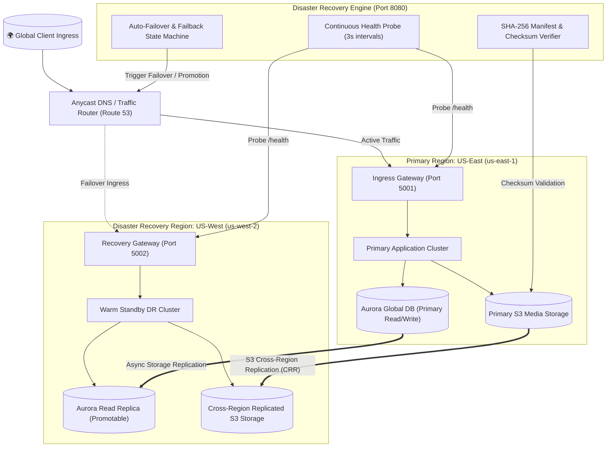
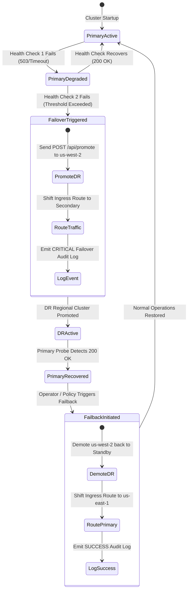
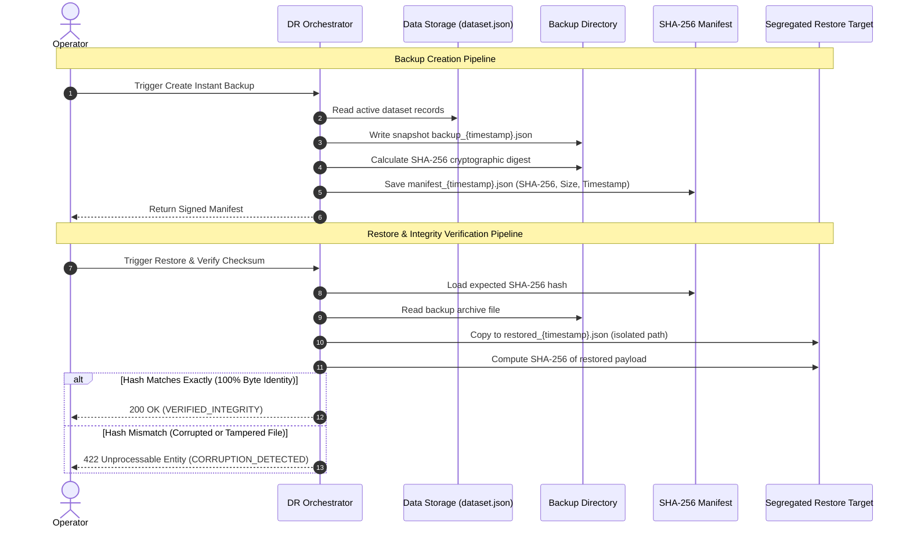

# Multi-Cloud Disaster Recovery & Backup Automation Platform — Architecture Specification

## 1. Executive Architecture Overview
The platform provides a high-availability, multi-region disaster recovery (DR) and automated cryptographic backup orchestration framework. Designed for business continuity across active and recovery zones, the system automates:
- Real-time continuous HTTP synthetic health probing.
- Multi-region active/standby ingress routing.
- Sub-second automated failure detection and promotion of standby secondary clusters.
- Repeatable failback restoration once primary cluster health returns to 100%.
- Cryptographically signed local/cloud backups using SHA-256 integrity manifests.
- Isolated restoration validation ensuring bit-level integrity before database hydration.

> [!NOTE]
> **Architectural Attribution**: The multi-region active-active cloud topology and AWS service selection (VPC, Aurora Global DB, S3 CRR, Route 53) references the foundational architecture described in [ShamailAbbas/aws-terraform-multi-region-active-active-disaster-recovery](https://github.com/ShamailAbbas/aws-terraform-multi-region-active-active-disaster-recovery). All orchestration logic, health probing, backup/restore verification, and dashboard systems are independently implemented original work.

---

## 2. Multi-Region Failover State Machine

The failover lifecycle ensures that no transient network spike causes an unnecessary regional shift while guaranteeing immediate failover when a true failure threshold is reached:

---

## 3. Cryptographic Backup & Restore Verification Flow

To prevent data rot, bit-flip errors, or compromised backup archives from polluting production datasets, the platform implements an immutable verification pipeline:

---

## 4. Terraform Multi-Region Foundation
The infrastructure foundation in `infra/` specifies:
1. **Multi-Provider Configuration**: Dual AWS provider blocks targeting `us-east-1` (primary) and `us-west-2` (secondary).
2. **Dual VPC Architecture**: Segregated VPCs across both regions with public/private subnet tiers, route tables, and Internet Gateways.
3. **Database Layer**: AWS Aurora Global Database cluster spanning primary and secondary regions for sub-second storage-level replication.
4. **Object Storage**: S3 bucket with versioning and Cross-Region Replication (CRR) configured via IAM replication roles.
5. **DNS & Health Routing**: Route 53 health check alarms with failover routing policies.
